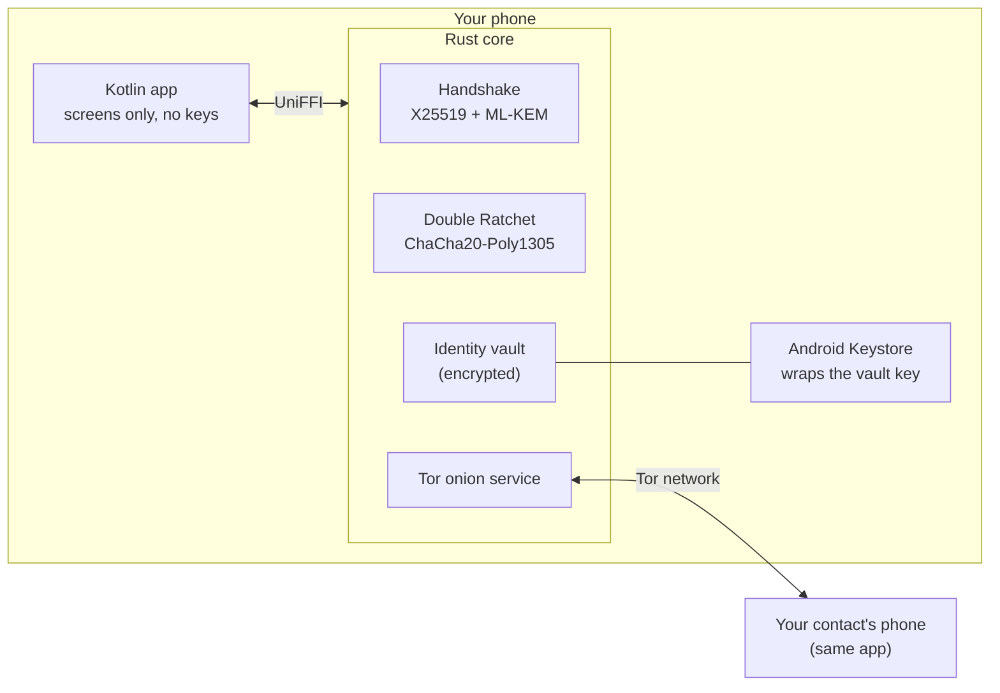
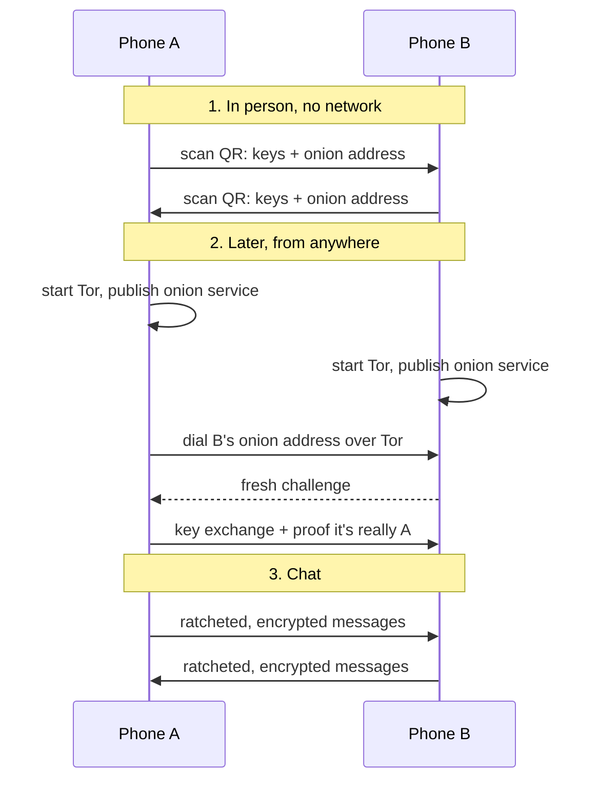
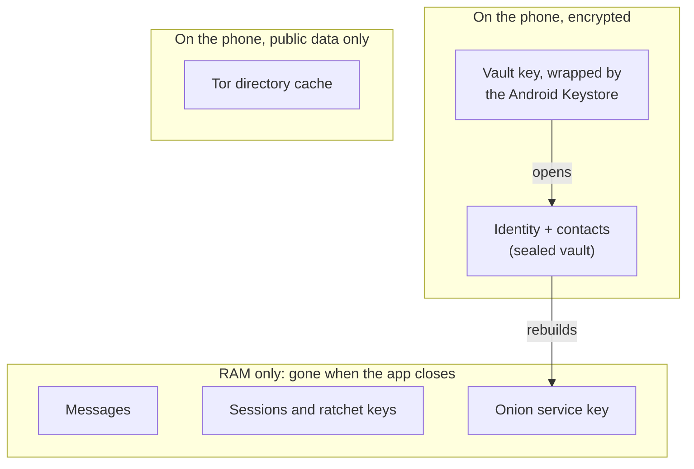

# Sovereign Mesh

A peer-to-peer messenger for Android, written entirely by an AI agent (Claude Haiku 5.5). It is experimental and has not been audited, so please don't use it for anything sensitive.

## What it is

A chat app for a small group of people, up to five. There are no servers: phones talk directly to each other.

The project is an experiment to see how an AI agent builds a "private & secure" messaging app. The AI writes all the code. A human runs the tests and decides what counts as working, and the AI's own claims don't count.

## How it works

- **Pairing:** you meet in person and scan each other's QR codes. That swaps the keys and each phone's address. The plan is to share the app in person too, not through a store.
- **Connecting:** each phone runs a Tor onion service, and messages travel over Tor. That lets you chat from anywhere, and the aim is that the network can't see who is talking to whom.
- **Encryption:** the key exchange uses X25519 and ML-KEM-768 (so it is post-quantum), and messages use a Double Ratchet with ChaCha20-Poly1305. It is end-to-end encrypted.
- **Messages:** they are kept in RAM only. Close the app and they're gone.
- **Contacts and keys:** these can be saved, but only encrypted. The vault key is wrapped by the Android Keystore.

The Rust core (`rust-core/`) does the crypto, storage and Tor. The Kotlin app (`app/`) is only the screens.







## Where it's at

- **Working:** the crypto core, the encrypted vault, the Tor transport, and an app that installs and starts on a phone. Over 300 automated tests pass. Two identities have chatted over the real Tor network on a laptop.
- **Not tested yet:** two real phones talking to each other. Until that works, nothing here claims it is private from someone watching the network.
- **Not reviewed:** nobody independent has checked the crypto.

More detail is in [docs/status.md](docs/status.md). [PLAN.md](PLAN.md) is the checklist and the log of decisions.

## Building it

```bash
mise run check          # lint and run every test
mise run android:debug  # build the debug APK
```

Setup for the Android SDK, NDK and Windows is in [docs/setup.md](docs/setup.md). The checks that need a person and a phone are in [docs/owner-test-list.md](docs/owner-test-list.md).

## Other

- Security problems: open a GitHub issue marked as a security report, and keep exploit details out of it until there is a fix.
- Licence: none yet, so all rights reserved.
- [CLAUDE.md](CLAUDE.md) has the rules the AI works under, and [llm.txt](llm.txt) is a short summary for AI tools.
