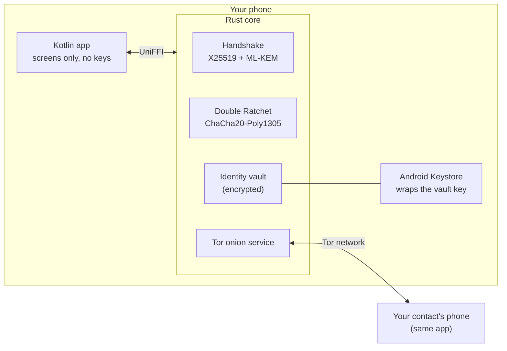
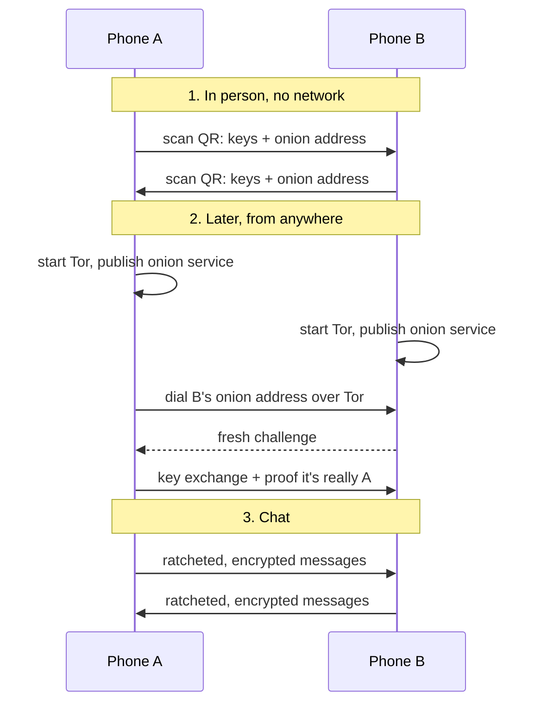
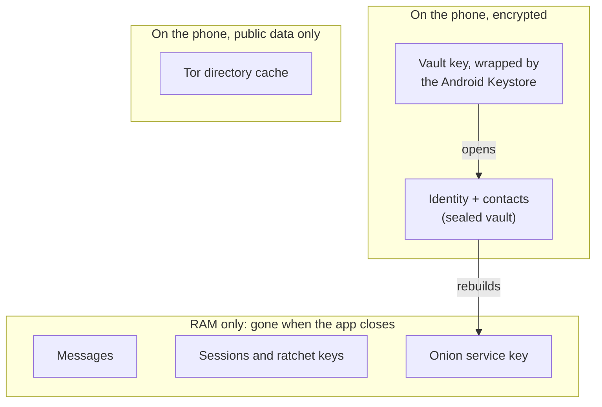

# Sovereign Mesh

**Can an AI build a private messaging app? We're finding out.**

> Experimental. Not audited. Please don't use it for anything sensitive.

## What is this?

It's an experiment. Every line of code in this repo (Rust, Kotlin, build scripts, even this README) was written by an AI agent, **Claude Haiku 5.5**, following instructions from the project owner.

The question: can an AI agent produce a "private & secure" messaging app, and how would you know if it did? So the AI does the building, and a human does the testing. Nothing counts as working until the human has run it. The AI's own claims don't count.

## The idea

- **No servers, no cloud.** Phones talk to each other directly.
- **Meet in person first.** You swap details by scanning QR codes, and you get the app itself from each other, not from a store.
- **Then chat from anywhere,** over Tor, so the network can't see who's talking to who.
- **End-to-end encrypted,** with post-quantum crypto in the key exchange.
- **Chats live in RAM only.** Close the app and they're gone.
- **Contacts and keys can be saved,** but only encrypted.

## How it fits together



## How two phones connect



## What lives where



## Where it's at

- **Done:** the crypto core, the Tor transport, the encrypted vault, and an Android app that installs and starts on a phone. More than 300 automated tests pass.
- **Done:** two identities chatted over the real Tor network on a laptop.
- **Not yet:** two real phones talking to each other. Until that works, there is **no claim** that it's private from someone watching the network.
- **Not yet:** anyone independent has reviewed the crypto.

The detailed version is in [docs/status.md](docs/status.md). [PLAN.md](PLAN.md) is the checklist and the log of every decision, including the ones the AI got wrong.

## Try it

```bash
mise run check          # lint and run every test
mise run android:debug  # build the debug APK
```

Android SDK, NDK and Windows notes: [docs/setup.md](docs/setup.md). Checks that need a human and a phone: [docs/owner-test-list.md](docs/owner-test-list.md).

## Found a problem?

It's a personal experiment. If you spot a security problem, open a GitHub issue marked as a security report, and keep exploit details out of it until there's a fix.

## Licence

None yet, so all rights reserved.

Other files: [CLAUDE.md](CLAUDE.md) holds the rules the AI works under, and [llm.txt](llm.txt) is a short summary for other AI tools.
